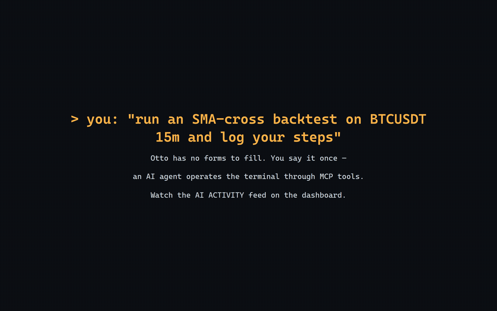

# Otto
<!-- mcp-name: io.github.0Smallcat0/otto -->

[](https://github.com/0Smallcat0/otto/actions/workflows/ci.yml)

A local financial terminal your AI agent operates for you. Market data, backtests, paper
books, news — driven in plain language, running entirely on your machine.



## Try it

Needs [uv](https://docs.astral.sh/uv/), Python 3.12 and [Claude Code](https://docs.anthropic.com/en/docs/claude-code). Install once, then register it:

```bash
uv tool install git+https://github.com/0Smallcat0/otto
claude mcp add otto -- otto-terminal
```

Install first, in a terminal: on a slow connection the first download can outlast the
30 or so seconds Claude Code gives an MCP server to start. If uv says its bin directory is
not on your PATH, run `uv tool update-shell` and open a new terminal. Update later with
`uv tool upgrade otto-terminal`.

Then ask for things:

- *"Refresh market data and show me the BTC snapshot."*
- *"Backtest an SMA cross on BTCUSDT and tell me if it's any good."*
- *"Use my paper book to buy $5,000 of AAPL, say why in one line, then show me the book."*

**The dashboard comes with it.** The MCP server starts the backend for you, and
<http://127.0.0.1:8765/> is the screen: books, calls and every order the agent placed.

## Run a round every day

A round is what the terminal is for: grade the open calls, scan for names with no view,
record a call only where there is a real thesis, place paper orders with a reason, then
snapshot the books. To run one, ask:

> *"Run one Otto decision round: grade my open calls, scan for gaps, record a call only
> where you have a real thesis, place paper orders with a rationale, then snapshot the
> books and report each against its benchmark."*

To have it run every morning on its own (Windows, PowerShell), save the runner and
register it once:

```powershell
iwr https://raw.githubusercontent.com/0Smallcat0/otto/main/scripts/run_decision_loop.ps1 -OutFile "$HOME\otto-round.ps1"
$run = New-ScheduledTaskAction -Execute powershell -Argument "-NoProfile -ExecutionPolicy Bypass -File `"$HOME\otto-round.ps1`""
Register-ScheduledTask OttoDailyRound -Action $run -Trigger (New-ScheduledTaskTrigger -Daily -At 9am)
```

Each run is one headless `claude -p` session on your Claude account (a test round on
2026-10-22 took 3 minutes, 33 turns and $1.18). It writes the theses in your Windows
display language — add `-Language English` after the `.ps1` path to pick another — and
appends its duration, turns and cost to `~/.otto/artifacts/loop/runs.jsonl`.

## Why this one

**It keeps score.** Every call the agent records — a stance, the reasoning, the price that
would prove it wrong, a horizon — is graded later against the price the market actually
printed and against its index (`0050.TW`, `SPY`, `BTC-USD`); a call without reasoning is
refused. **"An AI can operate it" is measured:** a real headless agent runs plain-language
tasks in hermetic sandboxes, graded on terminal state and artifacts, never by an LLM judge.

<!-- otto:eval -->
| Model | Passed | Avg turns | Run |
|---|---|---|---|
| `claude-sonnet-5` | 21 / 21 | 7.7 | 2026-08-16, 21-task suite |
| `claude-haiku-4-5` | 21 / 21 | 6.4 | 2026-08-16, 21-task suite |
<!-- otto:eval -->

Live trading, credential entry and code execution aren't switched off — they're
unreachable through the surface the agent has.

## Under the hood

<!-- otto:counts -->
One typed contract (142 actions across 16 routes) is the single source of truth; the MCP
tools, the UI capability catalog and the eval suite are all derived from it. 805 tests on
Windows + Linux CI.
<!-- otto:counts -->

- [Architecture](docs/architecture/ARCHITECTURE.md) · [ADRs](docs/architecture/)
- [AI operator guide](docs/AI_OPERATOR_GUIDE.md)
- [Eval methodology and full results](evals/EVAL.md)
- [Clean-room boundary](AGENTS.md) — built by observing a reference terminal's workflow,
  never by reading or porting its code; a [test](tests/test_clean_room_source_wall.py) fails
  the build if that wall is crossed.

The tests and the eval harness are not in the installed package, so these run from a
clone. The built dashboard is committed, so `uv run otto` needs no frontend build:

```bash
git clone https://github.com/0Smallcat0/otto && cd otto
uv run otto
uv run --extra dev python -m pytest -q
python evals/run_eval.py --model claude-sonnet-5
```

## License

[MIT](LICENSE).
